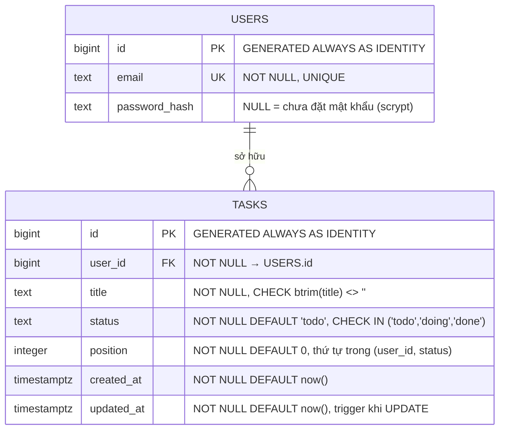

# Kiến trúc

## 1. Sơ đồ

```
Người dùng
   │ HTTPS (443)
   ▼
Cloudflare  (proxy bật, SSL mode = strict, min TLS 1.2, HTTP/3 + Brotli)
   │ TLS 1.2/1.3 tới origin
   ▼
nginx :443 trên VM Azure ──► gunicorn 127.0.0.1:8000 (Flask, 2 worker)
   │                                   │ psycopg_pool (min 1 / max 5)
   │                                   ▼
   │                    Neon PostgreSQL 17 "studydb" (TLS 1.3, verify-full)
   │
   ├─ :80  → 301 HTTPS (chừa /.well-known/acme-challenge/ cho ACME HTTP-01)
   └─ IP trực tiếp http://20.48.104.156/ → 301 về domain

Cùng VM (chỉ lab/backup, không phục vụ app):
   container postgres:17 @ 127.0.0.1:55432, volume cdb-study-data
   → nguồn dump/restore sang Neon và là mốc evidence của GĐ 2.
```

- `5432` **không** mở ra Internet; container local chỉ publish loopback.
- SSH (22) chỉ mở cho IP hiện tại của người vận hành.
- App không bao giờ kết nối bằng role owner; chỉ `app_user`.

## 2. Thành phần thực tế

| Thành phần | Giá trị |
|---|---|
| Resource group / VM | `rg-demo` / `vm-cdb` — `20.48.104.156`, japaneast |
| Size / OS | `Standard_B2pls_v2` (Arm64, 2 vCPU / 4 GiB), Ubuntu 24.04.5 LTS |
| Đĩa / swap | Standard SSD 30 GB, swap 2 GB |
| NSG | 22 ← IP vận hành; 80, 443 ← `*`; không có 5432 |
| Runtime | gunicorn 2 worker, Flask 3.1, psycopg 3.3, psycopg_pool 3.3 |
| App dir | `/opt/cdb/app`; venv `/opt/cdb/venv/bin/python` |
| Service | systemd `cdb-kanban` (`infra/deploy/cdb-kanban.service`) |
| nginx | site `cdb-kanban` + `conf.d/cloudflare-realip.conf` |
| Neon | project `icy-sound-48483515`, branch `br-silent-darkness-a1gqqmlj`, DB `studydb`, role `app_user` |
| Neon endpoint | `ep-ancient-bread-a13k7y58.ap-southeast-1.aws.neon.tech` (trực tiếp; pooled có tồn tại nhưng không dùng) |
| Domain | `kanban.akaine.io.vn` → Cloudflare proxy → origin |
| Cert origin | Let's Encrypt `CN=kanban.akaine.io.vn`, hạn 2027-02-07 |
| Local Postgres | container `cdb-study` (17.11), volume `cdb-study-data`, `127.0.0.1:55432` |

## 3. Data model



- Index `idx_tasks_user_status_position (user_id, status, position)` phục vụ lọc theo user +
  cột Kanban và sắp thứ tự; thay index cũ `idx_tasks_user_status`.
- FK `tasks.user_id → users.id`; xoá user phải xoá task trước (script test/purge làm đúng thứ tự).
- `users.password_hash` thêm bằng migration GĐ C; nullable để user cũ vẫn hợp lệ nhưng
  không đăng nhập được cho tới khi có hash.
- `tasks.position`/`created_at`/`updated_at` thêm bằng migration GĐ C (additive + idempotent)
  và backfill `position` theo `id` hiện có; `updated_at` do trigger `trg_tasks_updated_at`.
- DDL đầy đủ: `infra/db/schema.sql`. Migration up/down:
  `infra/maintenance/sql/2026-11-10-login*.sql` và
  `infra/maintenance/sql/2026-11-10-task-order*.sql`.

### Vì sao `status` thay vì `done boolean`

Đề gốc dùng `tasks.done boolean`, nhưng Kanban có 3 cột Todo/Doing/Done — boolean không
biểu diễn được `doing`. Đổi sang `text` + `CHECK` để miền giá trị vẫn bị chặn ở DB. Đây
là khác biệt có chủ ý, ghi ở [history.md](history.md) và [operations.md](operations.md).

## 4. Luồng request

1. **Trang tĩnh** (`/`, `/login`, `/register`, `/app.css`, `/app.js`): Flask phục vụ file
   trong `/opt/cdb/app`. Trang và API trả `Cache-Control: no-store`; CSS/JS trả `no-cache`
   ở origin, nhưng Cloudflare vẫn cache ~4 h → **bắt buộc tăng `?v=`** khi đổi asset.
2. **Xác thực**: `before_request` chặn mọi trang (trừ `/login`, `/register`, asset) và mọi
   `/api/*` (trừ `/api/login`, `/api/register`, `/api/health`). Thiếu session → API 401
   JSON, trang 302 `/login`.
3. **API**: `user_id` client gửi lên phải khớp `session.uid` (`403 forbidden_user`); task
   của user khác trả `404` để không lộ sự tồn tại. Mọi SQL tham số hoá.
4. **DB**: `psycopg_pool` giữ 1–5 connection tới Neon. Pool có `check_connection`,
   `max_idle=120`, `max_lifetime=1800`, `reconnect_timeout=30`, retry 1 lần khi
   `OperationalError` — đủ để Neon Free scale-to-zero không gây 500.
5. **IP thật**: nginx `real_ip_header CF-Connecting-IP`, chỉ tin dải Cloudflare
   (`infra/deploy/nginx-cloudflare-realip.conf`) rồi ghi đè `X-Forwarded-For`; Flask dùng
   `ProxyFix(x_for=1, x_proto=1, x_host=1)`. Log thấy IP người dùng, không phải IP CF.
6. **Log**: mỗi request một dòng `METHOD path status Xms ip=...` vào journald; không ghi
   body/header/token.

## 5. Đường deploy

```
push main ──► GitHub Actions
                ├─ CI (ubuntu-latest): postgres:17 + schema + ci-smoke.py (57 case)
                └─ Deploy (sau CI xanh, workflow_run)
                     └─ self-hosted runner cdb-vm (trên VM, outbound HTTPS)
                          └─ sudo bash infra/deploy/deploy.sh "$GITHUB_WORKSPACE"
                               ├─ backup /opt/cdb/app/backup-<stamp>/ + nginx conf
                               ├─ install app + nginx conf
                               ├─ nginx -t && reload
                               ├─ restart cdb-kanban
                               └─ health 3 mức, retry 10×2 s; lỗi → rollback
```

Không cần mở SSH cho GitHub-hosted runner (NSG chỉ mở 22 từ IP hiện tại). Runner chạy
bằng systemd service `actions.runner.quanq026-cdb-kanban-lab.cdb-vm-runner`, label
`[self-hosted, cdb-vm]`.

Rollback tự động nằm trong `infra/deploy/deploy.sh` (`trap ERR`). Quy trình thủ công và
rollback theo từng mốc: [operations.md](operations.md).

## 6. Quyết định thiết kế đáng chú ý

| Quyết định | Lý do |
|---|---|
| Giữ `rg-demo` / japaneast, `Standard_B2pls_v2` Arm64 | B-series nhỏ bị `NotAvailableForSubscription` hoặc hết capacity ở japaneast/southeastasia |
| Dùng project Neon sẵn có, chỉ thêm DB `studydb` | Org do Vercel quản lý, API tạo project bị khoá; không đụng `neondb` |
| `app_user` thay vì owner | Least privilege: không superuser/CREATEDB/CREATEROLE/BYPASSRLS |
| `DB_SSLROOTCERT=/etc/ssl/certs/ca-certificates.crt` | `sslrootcert=system` không hợp với libpq bundled của `psycopg[binary]`; vẫn `verify-full` |
| HTTPS ở origin | Cloudflare SSL strict cần 443; thiếu TLS → lỗi 521. nginx 1.24 không có `http2 on;` nên dùng `listen 443 ssl http2;` |
| `/api/health` hai mức | Bản công khai không lộ host/database/sslmode; `?detail=1` chỉ localhost |
| Không rate limit | Yêu cầu của chủ demo; đánh đổi được ghi ở [security.md](security.md) §6 |
| `DELETE` dùng query string | Body trên DELETE không được mọi proxy/client xử lý nhất quán |
| 1 CSS + 1 JS, CSP không `unsafe-inline` | Dễ cache/bump `?v=`, CSP chặt, không inline script/style |

## 7. Khác so với đề bài

| Đề | Đã làm | Lý do |
|---|---|---|
| `tasks.done boolean` | `tasks.status text` + `CHECK (status IN ('todo','doing','done'))` | Kanban 3 cột cần biểu diễn `doing`; `CHECK` vẫn chặn miền giá trị ở DB |
| `users(id, email)` | thêm `password_hash text` (nullable) | Cần chỗ lưu hash scrypt cho login thật; user cũ vẫn hợp lệ |
| Region `southeastasia` | `japaneast` | B-series bị `NotAvailableForSubscription` ở southeastasia (policy/SKU) |
| Size `Standard_B2ats_v2` | `Standard_B2pls_v2` (Arm64) | SKU không khả dụng + hết capacity các size B nhỏ |
| Tạo project Neon mới | thêm DB `studydb` vào project có sẵn | Org do Vercel quản lý, API tạo project bị khoá; không đụng `neondb` |
| nginx chỉ proxy cổng 80 | thêm 443 + Let's Encrypt | Domain đi qua Cloudflare SSL strict; thiếu TLS origin → 521 |
| (bổ sung) `/api/users` | chỉ trả user hiện tại | Giữ tương thích UI cũ, không lộ user khác |
| (bổ sung) `DB_SSLMODE`/`DB_SSLROOTCERT` | verify-full + CA bundle | Neon bắt buộc TLS; không tắt xác minh |
