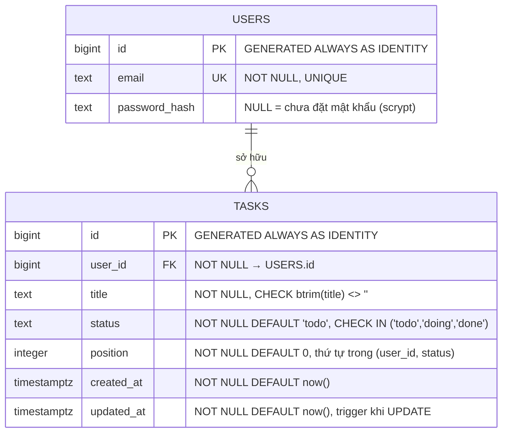

# Kiến trúc

## 1. Sơ đồ

```
Người dùng
   │ HTTPS (443)
   ▼
Cloudflare  (proxy, SSL strict, min TLS 1.2, HTTP/3 + Brotli)
   │ TLS 1.2/1.3 tới origin
   ▼
nginx :443 trên VM
   │ proxy_pass 127.0.0.1:8000
   ▼
docker: cdb-app (image ghcr.io/<owner>/cdb-kanban:<sha>)
   │ gunicorn 0.0.0.0:8000 trong container, bind ra host chỉ loopback
   │ psycopg_pool (min 1 / max 5)
   ▼
Neon PostgreSQL 17 "studydb" (TLS 1.3, verify-full)

nginx :80 → 301 HTTPS (chừa /.well-known/acme-challenge/ cho ACME HTTP-01)
```

- Container publish `127.0.0.1:8000:8000` — app vẫn chỉ nghe loopback trên VM.
- `5432` **không** mở ra Internet; SSH (22) chỉ mở cho IP vận hành.
- App không bao giờ kết nối bằng role owner; chỉ `app_user`.
- Image chạy non-root (`UID 10001`), `read_only: true`, `cap_drop: ALL`,
  `no-new-privileges`, tmpfs cho `/tmp`.

## 2. Thành phần

| Thành phần | Giá trị |
|---|---|
| Resource group / VM | `<resource-group>` / `<vm-name>` — region tuỳ chọn |
| Size / OS | Arm64 2 vCPU / 4 GiB, Ubuntu 24.04 LTS |
| Đĩa / swap | SSD 30 GB, swap 2 GB |
| NSG | 22 ← IP vận hành; 80, 443 ← `*`; không có 5432 |
| Runtime | Docker container `cdb-app`: python:3.12-slim, gunicorn 2 worker, Flask 3.1, psycopg 3.3, psycopg_pool 3.3 |
| Image | `ghcr.io/<owner>/cdb-kanban:<sha>` (build arm64 trong CI, tag `latest` không dùng để deploy) |
| App dir | `/app` trong image; compose + tag hiện tại ở `/opt/cdb/` |
| Service | `docker compose`, restart `unless-stopped` |
| Web / Proxy | Caddy (tự cấp SSL) hoặc Nginx reverse proxy |
| Neon | DB `studydb`, role `app_user`, endpoint trực tiếp (không `-pooler`) |
| Domain | `<domain>` → Proxy → App |
| Cert origin | Let's Encrypt `CN=<domain>` |

## 3. Data model



- Index `idx_tasks_user_status_position (user_id, status, position)` phục vụ lọc theo user +
  cột Kanban và sắp thứ tự.
- FK `tasks.user_id → users.id`; xoá user phải xoá task trước.
- `users.password_hash` nullable để user cũ vẫn hợp lệ nhưng không đăng nhập được cho tới
  khi có hash.
- `tasks.position`/`created_at`/`updated_at` thêm bằng migration additive + idempotent;
  `updated_at` do trigger `trg_tasks_updated_at`.
- DDL đầy đủ: `infra/setup/schema.sql`. Migration up/down: `infra/migrations/`.

### Vì sao `status` thay vì `done boolean`

Kanban có 3 cột Todo/Doing/Done — boolean không biểu diễn được `doing`. Dùng `text` +
`CHECK` để miền giá trị vẫn bị chặn ở DB.

## 4. Luồng request

1. **Trang tĩnh** (`/`, `/login`, `/register`, `/app.css`, `/app.js`): Flask phục vụ file
   trong `/app` (bên trong image). Trang và API trả `Cache-Control: no-store`; CSS/JS trả
   `no-cache` ở origin. `app.py` gắn `?v=<sha1 8 ký tự>` vào hai asset một lần lúc khởi
   động, nên URL đổi khi nội dung đổi.
2. **Xác thực**: `before_request` chặn mọi trang (trừ `/login`, `/register`, asset) và mọi
   `/api/*` (trừ `/api/login`, `/api/register`, `/api/health`). Thiếu session → API 401
   JSON, trang 302 `/login`.
3. **API**: `user_id` client gửi lên phải khớp `session.uid` (`403 forbidden_user`); task
   của user khác trả `404` để không lộ sự tồn tại. Mọi SQL tham số hoá.
4. **DB**: `psycopg_pool` giữ 1–5 connection tới Neon. Pool có `check_connection`,
   `max_idle=120`, `max_lifetime=1800`, `reconnect_timeout=30`, retry 1 lần khi
   `OperationalError` — đủ để Neon Free scale-to-zero không gây 500.
5. **IP thật**: nginx `real_ip_header CF-Connecting-IP`, chỉ tin dải Cloudflare
   (`infra/ops/nginx-cloudflare-realip.conf`) rồi ghi đè `X-Forwarded-For`; Flask dùng
   `ProxyFix(x_for=1, x_proto=1, x_host=1)`. Log thấy IP người dùng, không phải IP CF.
6. **Log**: mỗi request một dòng `METHOD path status Xms ip=...` ra stdout container
   (`--access-logfile -`), Docker json-file driver xoay 10 MB × 3; không ghi
   body/header/token.

## 5. Đường deploy

```
push main ──► GitHub Actions
                ├─ CI (ubuntu-latest): postgres:17 + schema + ci-smoke.py + lint
                └─ Image (ubuntu-24.04-arm): hadolint + build arm64 + trivy
                     └─ push main: ghcr.io/<owner>/cdb-kanban:<sha> (+ latest)
                                        │
                                        ▼
                     Deploy (sau CI xanh, workflow_run)
                       └─ self-hosted runner cdb-vm (trên VM, outbound HTTPS)
                            ├─ docker login ghcr.io bằng GITHUB_TOKEN
                            ├─ docker pull <repo>:<sha> (user runner, group docker)
                            └─ sudo env IMAGE_TAG=<sha> bash infra/ops/deploy.sh
                                 ├─ pull chỉ khi thiếu image
                                 ├─ ghi /opt/cdb/current_tag + previous_tag
                                 ├─ docker compose up -d
                                 ├─ backup nginx conf → cài mới → nginx -t → reload
                                 ├─ health 10×2 s; lỗi → nginx + compose về bản cũ
                                 └─ prune image, giữ 3 tag gần nhất
```

Không cần mở SSH cho GitHub-hosted runner. Runner chạy bằng systemd, label
`[self-hosted, cdb-vm]`, user thuộc group `docker`.

Rollback tự động nằm trong `infra/ops/deploy.sh` (`trap ERR`). Quy trình thủ công:
[operations.md](operations.md).

## 6. Quyết định thiết kế đáng chú ý

| Quyết định | Lý do |
|---|---|
| `app_user` thay vì owner | Least privilege: không superuser/CREATEDB/CREATEROLE/BYPASSRLS |
| `DB_SSLROOTCERT=/etc/ssl/certs/ca-certificates.crt` | `sslrootcert=system` không hợp với libpq bundled của `psycopg[binary]`; vẫn `verify-full` |
| HTTPS ở origin | Cloudflare SSL strict cần 443; thiếu TLS → lỗi 521 |
| `/api/health` hai mức | Bản công khai không lộ host/database/sslmode; `?detail=1` chỉ localhost |
| Image arm64 + tag SHA | VM là Arm64; deploy/rollback chỉ đổi tag, không build trên VM |
| Container read-only, non-root | Giảm bề mặt nếu app bị lỗi; chỉ `/tmp` ghi được |
| Không rate limit | Đánh đổi được ghi ở [security.md](security.md) §6 |
| `DELETE` dùng query string | Body trên DELETE không được mọi proxy/client xử lý nhất quán |
| 1 CSS + 1 JS, CSP không `unsafe-inline` | Asset cache bằng `?v=` tự sinh, CSP chặt, không inline script/style |

## 7. Khác so với đề bài

| Đề | Đã làm | Lý do |
|---|---|---|
| `tasks.done boolean` | `tasks.status text` + `CHECK` | Kanban 3 cột cần biểu diễn `doing` |
| `users(id, email)` | thêm `password_hash text` (nullable) | Cần chỗ lưu hash scrypt cho login |
| nginx chỉ proxy cổng 80 | thêm 443 + Let's Encrypt | Cloudflare SSL strict cần TLS origin |
| (bổ sung) `/api/users` | chỉ trả user hiện tại | Giữ tương thích UI, không lộ user khác |
| (bổ sung) `DB_SSLMODE`/`DB_SSLROOTCERT` | verify-full + CA bundle | Neon bắt buộc TLS; không tắt xác minh |
