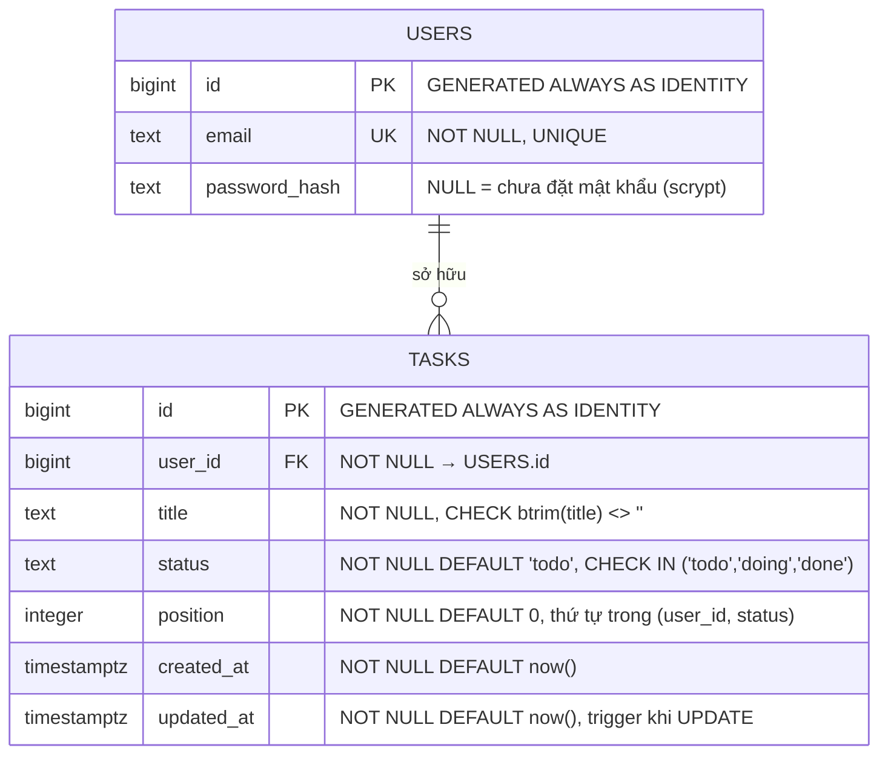

# Kiến trúc

## 1. Sơ đồ hệ thống

```
Người dùng / Trình duyệt
   │ HTTPS (cổng 80, 443)
   ▼
Caddy (:80/:443, caddy:2-alpine)
   │ ├─ Tự động cấp & gia hạn chứng chỉ SSL (Let's Encrypt / ZeroSSL)
   │ ├─ Tự động chuyển hướng HTTP :80 → HTTPS :443
   │ └─ reverse_proxy app:8000 (mạng bridge nội bộ Docker)
   ▼
Docker: cdb-app (python:3.12-slim, non-root UID 10001)
   │ gunicorn 2 workers :8000, Flask 3.1
   │ psycopg_pool (min 1 / max 5)
   ▼
Docker: cdb-db (postgres:17-alpine)
   │ PostgreSQL 17, database "studydb", user "app_user"
   │ Khởi tạo tự động từ /docker-entrypoint-initdb.d/ (schema.sql, seed.sql)
   │ Dữ liệu lưu bền vững qua Docker volume: db_data
   └─ Lắng nghe cổng 5432 trong mạng Docker nội bộ (không mở ra host hay Internet)
```

- **Mạng cô lập**: Giao tiếp giữa `caddy`, `app` và `db` diễn ra trên mạng Docker nội bộ.
- **Bảo mật cổng**: Chỉ cổng 80 và 443 (cùng 443/udp) của Caddy mở ra Internet. Database chỉ giao tiếp nội bộ trong mạng compose, không expose port ra host.
- **Phân quyền ứng dụng**: App container chạy non-root (`UID 10001`), `read_only: true`, `cap_drop: ALL`, `no-new-privileges`, tmpfs cho `/tmp`.

## 2. Thành phần

| Thành phần | Giá trị |
|---|---|
| Hệ điều hành host | Mọi bản phân phối Linux hỗ trợ Docker (Ubuntu, Debian, Fedora, v.v., x86_64 hoặc ARM64) |
| Runtime | Docker & Docker Compose v2 |
| Proxy & SSL | Caddy 2 (`caddy:2-alpine`), tự động quản lý TLS Let's Encrypt |
| Application | Flask 3.1, Gunicorn 26.2, Psycopg 3.3, Psycopg-pool 3.3 |
| Database | PostgreSQL 17 (`postgres:17-alpine`), DB `studydb`, role `app_user` |
| Volume lưu trữ | `db_data` (Postgres data), `caddy_data` (SSL certs), `caddy_config` |
| Image build | Build trực tiếp từ `Dockerfile` tại máy đích hoặc pull từ GHCR |

## 3. Data model



- Index `idx_tasks_user_status_position (user_id, status, position)` phục vụ lọc theo user + cột Kanban và sắp thứ tự.
- FK `tasks.user_id → users.id`; xoá user phải xoá task trước.
- `users.password_hash` nullable để tương thích dữ liệu mẫu và bảo vệ đăng nhập.
- `tasks.updated_at` do trigger `trg_tasks_updated_at` tự động cập nhật khi có `UPDATE`.
- DDL đầy đủ: `infra/setup/schema.sql`. Dữ liệu mẫu demo: `infra/setup/seed.sql`.

### Vì sao `status` thay vì `done boolean`

Kanban có 3 cột Todo/Doing/Done — boolean không biểu diễn được `doing`. Dùng `text` + `CHECK` để miền giá trị được kiểm soát chặt chẽ ở DB.

## 4. Luồng request

1. **Trang tĩnh** (`/`, `/login`, `/register`, `/app.css`, `/app.js`): Flask phục vụ file trong `/app`. Trang và API trả `Cache-Control: no-store`; CSS/JS trả `no-cache`. `app.py` gắn `?v=<sha1 8 ký tự>` vào asset một lần lúc khởi động, đảm bảo cache buster hoạt động chính xác.
2. **Xác thực**: `before_request` chặn mọi trang (trừ `/login`, `/register`, asset) và mọi `/api/*` (trừ `/api/login`, `/api/register`, `/api/health`). Thiếu session → API 401 JSON, trang 302 `/login`.
3. **API**: `user_id` client gửi lên phải khớp `session.uid` (`403 forbidden_user`); task của user khác trả `404` để không lộ sự tồn tại. Mọi SQL đều tham số hoá (%s).
4. **DB Connection Pool**: `psycopg_pool` giữ 1–5 connection tới container `db`. Pool có `check_connection`, `max_idle=120`, `max_lifetime=1800`, `reconnect_timeout=30`, retry 1 lần khi `OperationalError`.
5. **IP thật & Reverse Proxy**: Caddy reverse proxy tới `app:8000` kèm header `X-Forwarded-For`, `X-Forwarded-Proto`. Flask sử dụng `ProxyFix(x_for=1, x_proto=1, x_host=1)` để nhận diện đúng IP client.
6. **Log**: Mỗi request một dòng `METHOD path status Xms ip=...` ra stdout container, Docker json-file driver xoay 10 MB × 3; không ghi body/header/mật khẩu.

## 5. Quy trình triển khai (Deploy)

Hệ thống được thiết kế dạng **All-in-One Plug & Play**:

```text
git clone <repo> && cd cdb-kanban-lab
       │
       ▼
cp .env.example .env && nano .env (điền DOMAIN, APP_SECRET_KEY)
       │
       ▼
docker compose up -d --build
       │
       ├─ Khởi động db: mount schema.sql & seed.sql khởi tạo dữ liệu
       ├─ Build app: đóng gói Flask & Gunicorn non-root
       └─ Khởi động caddy: tự kết nối ACME Let's Encrypt cấp SSL cho DOMAIN
```

## 6. Quyết định thiết kế đáng chú ý

| Quyết định | Lý do |
|---|---|
| PostgreSQL 17 container nội bộ | Độc lập hoàn toàn, không phụ thuộc cloud ngoài, tự động nạp schema/seed lần đầu |
| Caddy Reverse Proxy | Tự động hóa 100% việc cấp phát và gia hạn SSL Let's Encrypt, cấu hình cực ngắn |
| Tối giản `.env` | Mọi thông số DB nội bộ đều có giá trị mặc định an toàn; người dùng chỉ cần điền DOMAIN và SECRET_KEY |
| Cô lập DB trong mạng Compose | Port 5432 chỉ mở trong mạng bridge nội bộ cho app, không expose ra host hay Internet |
| Container read-only, non-root | Giảm thiểu bề mặt tấn công nếu app có lỗ hổng; chỉ `/tmp` cho phép ghi tạm |
| Không cần build ngoài | Bất kỳ máy nào có Docker Compose đều có thể build và chạy ngay lập tức |
