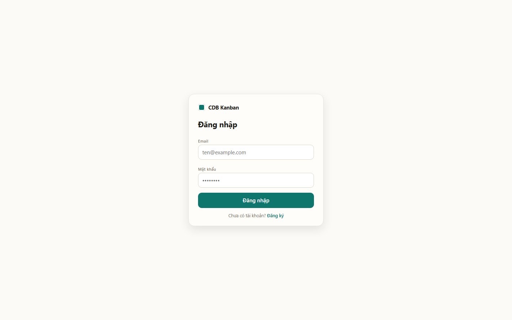
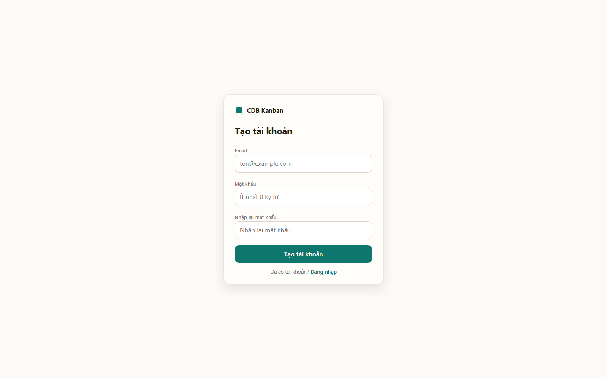
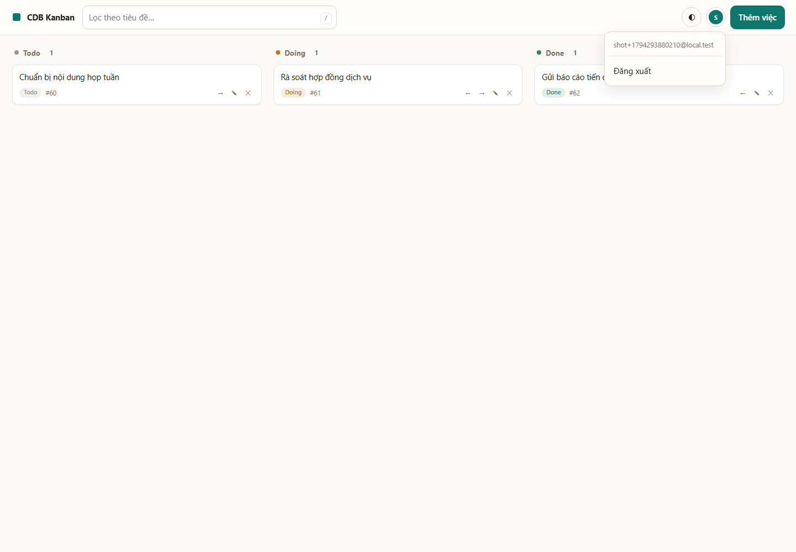
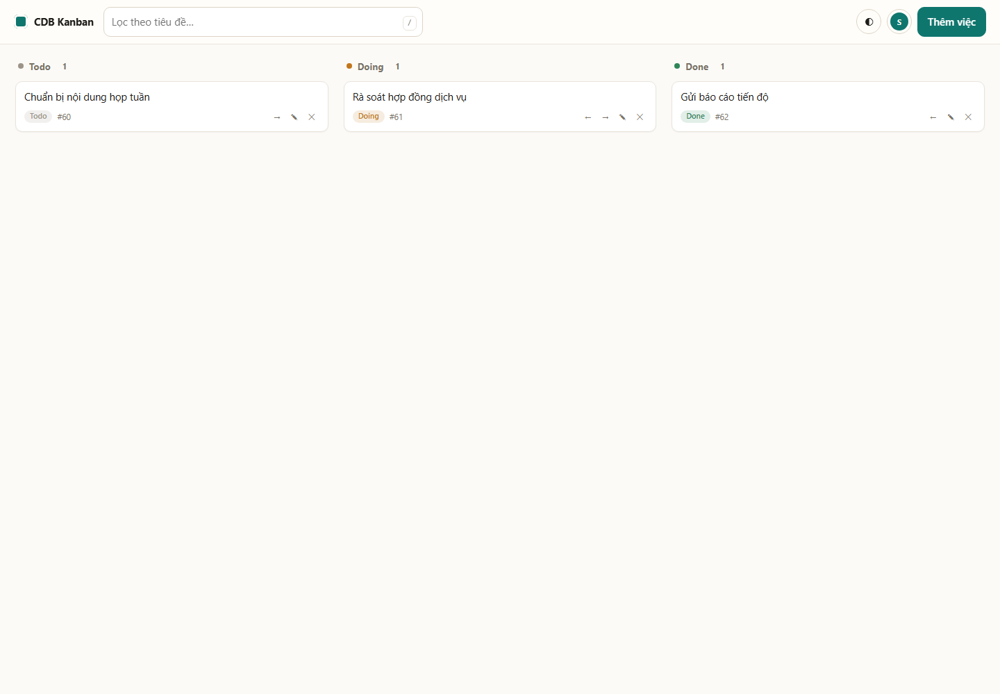
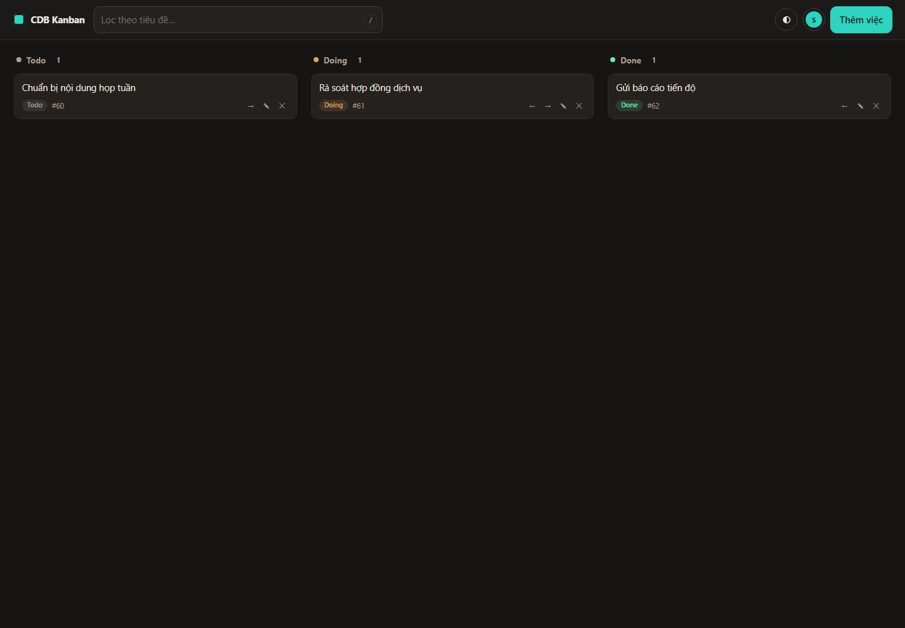
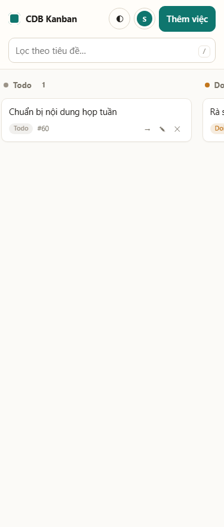
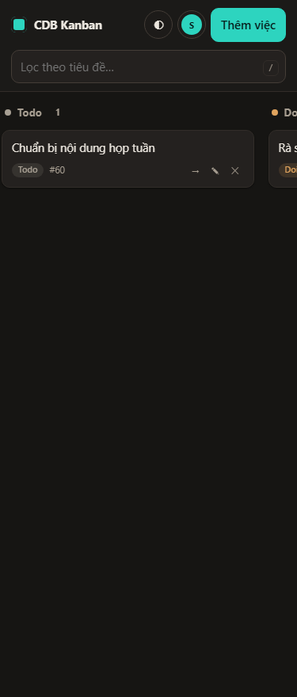

# Evidence — UI

- Thời điểm: `2026-11-10`, sau deploy GĐ A + B + B+ + login/register + **bỏ rate limit,
  top bar gọn, bỏ footer**; Neon đã purge demo.
- URL: `https://kanban.akaine.io.vn/` · `/login` · `/register`
- Công cụ: Chrome headless qua CDP (`infra/test/ui-shots.mjs`), emulation đúng `width`,
  `mobile`, `prefers-color-scheme`.
- Script tự đăng ký `shot+<ts>@local.test`, chụp board trống, tạo 3 việc mẫu
  (1 Todo / 1 Doing / 1 Done), chụp board + menu tài khoản. Không cần seed/mật khẩu.

## 1. Lệnh chạy

```powershell
node infra\test\ui-shots.mjs docs\evidence\images
powershell -File infra\tools\run-remote.ps1 -Path infra\maintenance\purge-test-accounts.sh
```

## 2. Metadata thật (`ui-shots.json`)

| Ảnh | Bytes | ready | path | counts | menuOpen | hasFooter | bg | width |
|---|---:|---|---|---|---|---|---|---:|
| `ui-login-light.png` | 19692 | true | `/login` | – | – | – | `rgb(251, 250, 247)` | 1440 |
| `ui-register-light.png` | 23367 | true | `/register` | – | – | – | `rgb(251, 250, 247)` | 1440 |
| `ui-empty-light.png` | 24036 | true | `/` | `0/0/0` | false | false | `rgb(251, 250, 247)` | 1440 |
| `ui-desktop-light.png` | 25241 | true | `/` | `1/1/1` | false | false | `rgb(251, 250, 247)` | 1440 |
| `ui-desktop-dark.png` | 25525 | true | `/` | `1/1/1` | false | false | `rgb(22, 21, 19)` | 1440 |
| `ui-menu-light.png` | 31116 | true | `/` | `1/1/1` | true | false | `rgb(251, 250, 247)` | 1440 |
| `ui-mobile-light.png` | 15100 | true | `/` | `1/1/1` | false | false | `rgb(251, 250, 247)` | 375 |
| `ui-mobile-dark.png` | 15437 | true | `/` | `1/1/1` | false | false | `rgb(22, 21, 19)` | 375 |

`hasFooter=false` ở mọi ảnh board/empty; `ui-menu-light.png` chụp menu avatar đang mở
(email + `Đăng xuất`). `bg` khớp token design B: sáng `#fbfaf7`, tối `#161513`;
`width` đúng 1440/375 → breakpoint + `prefers-color-scheme` chạy thật.

> Metadata gốc đo tại `evidence/`; sau khi gộp repo, trường `file` được remap sang
> `docs/evidence/images/`. Số đo (`bytes`, `meta`) giữ nguyên.

### Ảnh

| | |
|---|---|
|  |  |
|  |  |
|  |  |
|  |  |

## 3. Design B

- 1 accent teal `#0f766e` (dark `#2dd4bf`) + neutral ấm; token CSS cho light/dark.
- Màu trạng thái: Todo xám, Doing cam `#c2761c`, Done xanh `#2f855a`; chip trên mỗi thẻ.
- Radius 10–14 px, không viền cột, thẻ hover nâng nhẹ; drag có nghiêng/giảm opacity.
- Avatar tròn mở menu (email + Đăng xuất); theme 3 trạng thái `auto → light → dark`.
- Top bar 1 hàng desktop, 2 hàng mobile (search full width).
- Motion 150–200 ms; `prefers-reduced-motion` tắt animation.
- Login/register layout riêng (`.auth-*`, `.auth-alt`), cùng token, link qua lại.

## 4. Kiểm tra browser thật

| Bước | Kết quả |
|---|---|
| Mở `/` chưa đăng nhập | 302 → `/login`; form login, board không lộ |
| Mở `/register` | 200; 3 field, link "Đã có tài khoản? Đăng nhập" |
| Mật khẩu 7 ký tự / nhập lại sai | lỗi inline, không gửi request |
| Đăng ký hợp lệ | 201 → tự đăng nhập `/`, board trống `0/0/0` + 3 empty state |
| Không footer | `document.getElementById("footer")` = `null` |
| Menu tài khoản | avatar → mở (`aria-expanded=true`), email + `Đăng xuất`; click ngoài/Esc đóng, Esc trả focus |
| Theme | `auto → light → dark → auto`; nền `rgb(251,250,247)` ↔ `rgb(22,21,19)` |
| Thêm việc (`N`/nút) | dialog, submit disable khi gửi, 201, toast `Đã thêm việc` |
| Sửa tiêu đề (`✎` → Enter) | PATCH `title` 200, chữ đổi tại chỗ |
| Chuyển cột `→` | optimistic, PATCH 200, đếm cột + chip đổi |
| Lọc | không khớp → 0 thẻ + empty state |
| `/` | focus ô tìm kiếm |
| Xoá | `<dialog>` xác nhận `#55 — Việc kiểm thử đăng ký (Doing)` → DELETE 200, về 3 empty state |
| Đăng xuất | 200 → `/login`; `/api/me`, `/api/tasks` 401 |
| Đăng ký trùng email qua form | 409, inline `du lieu da ton tai` |
| Console | **0 error** |

## 5. Lỗi tìm thấy & sửa

- Banner `#slow` dùng `hidden` nhưng `.slow{display:flex}` đè UA → thêm
  `.slow[hidden]{display:none}`; chụp lại toàn bộ.
- Cache asset: HTML mới + JS cũ → `TypeError: ... addEventListener of null`, board trắng.
  Sửa `?v=20261110f` + origin `no-cache`; Cloudflare vẫn cache ~4 h → **luôn bump `?v=`**.
- Test chuyển cột ngay sau lưu bị bỏ qua vì `busy` (guard double-submit) — hành vi đúng.
- Script ảnh phải `Page.navigate` lại sau khi đăng ký/tạo task qua `fetch`.

## 6. Ghi chú

- Kéo–thả chuột dùng HTML5; cảm ứng dùng nút `←`/`→` (đề cho phép phương án thay thế).
- Ảnh là bằng chứng trực quan; số liệu/hành vi lấy từ DOM thật.
- Bộ ảnh cũ (7 ảnh, có footer) đã bị thay; metadata cũ không còn trong `ui-shots.json`.
- Mockup 2 phương án thiết kế: [../design/options.html](../design/options.html) ·
  [../design/options.png](../design/options.png).
