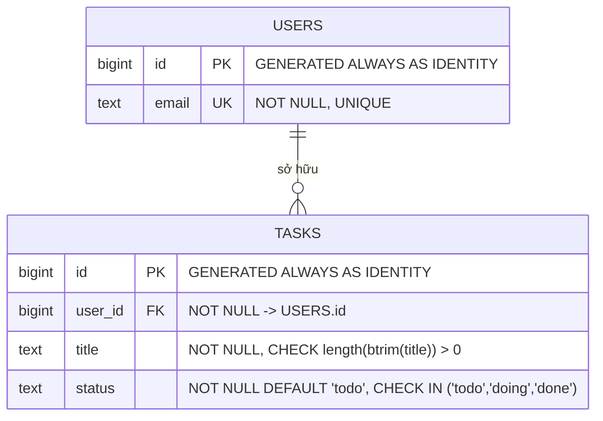
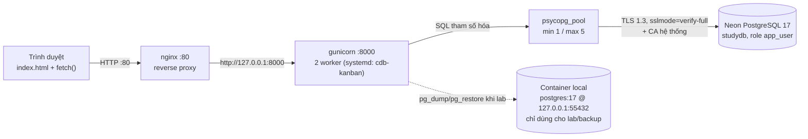
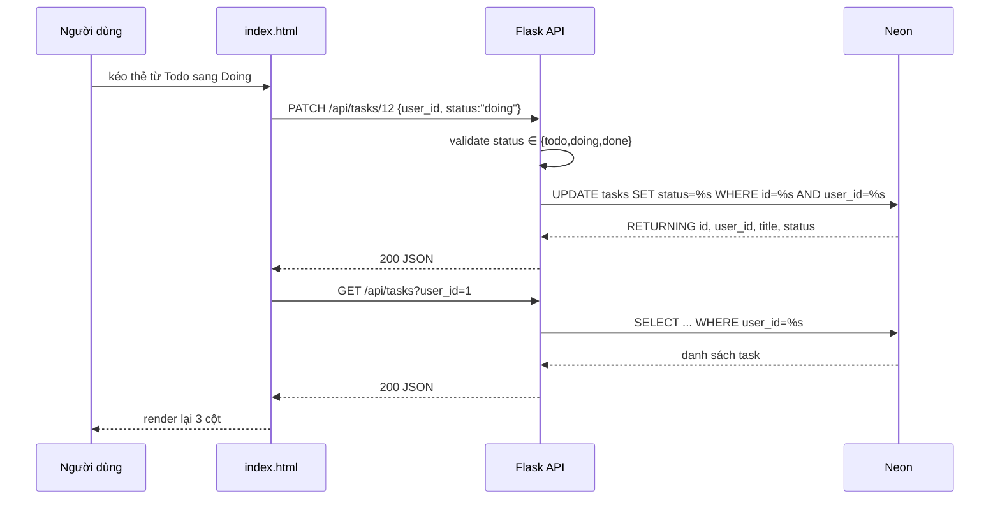

# Sơ đồ hệ thống

## 1. ER — users / tasks

Index: `idx_tasks_user_status (user_id, status)` phục vụ truy vấn lọc theo user + cột Kanban.

## 2. Luồng request

## 3. Luồng dữ liệu của một thao tác Kanban

